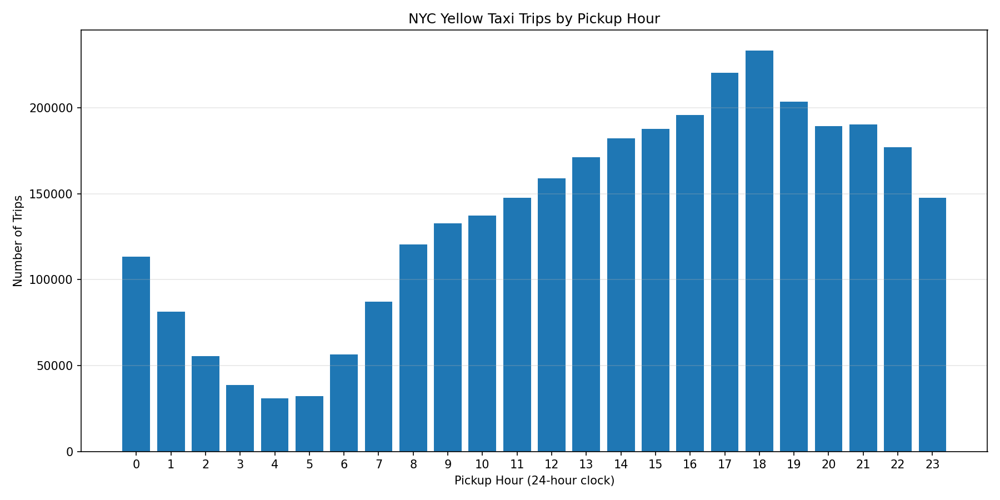
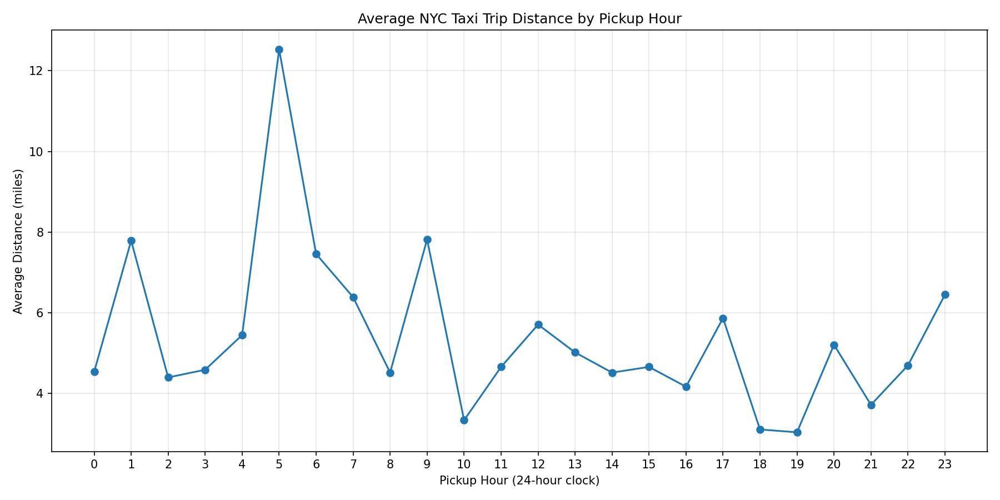
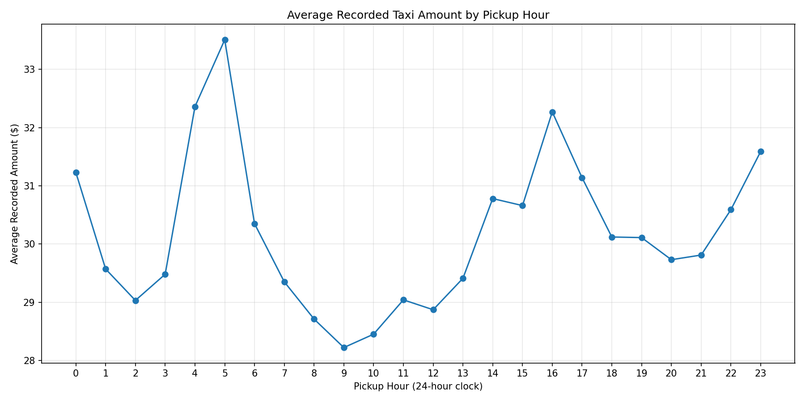

# NYC Taxi Trip Data Analytics

## Project Overview

This project analyzes New York City yellow taxi trip data using Python, SQL, and DuckDB. The goal is to explore trip patterns, examine fare and distance metrics, identify data-quality issues, and demonstrate a reproducible data analytics workflow.

The project includes data inspection, data cleaning, SQL-based analysis, and visualizations to communicate findings about taxi activity throughout the day.

## Tools and Technologies

- **Python** — data processing and analysis
- **Pandas** — data inspection and manipulation
- **DuckDB** — SQL queries and analytical summaries
- **Matplotlib** — data visualization
- **PyArrow** — Parquet file support
- **SQL** — aggregation, filtering, and data-quality analysis
- **Git and GitHub** — version control and project sharing

## Dataset

The project uses a yellow taxi trip-record Parquet file identified as `yellow_tripdata_2026-08.parquet`, obtained from the NYC Taxi and Limousine Commission's Trip Record Data page.

Official data source: [NYC TLC Trip Record Data](https://www.nyc.gov/site/tlc/about/tlc-trip-record-data.page)

The analysis focuses on trips with pickup timestamps in August 2026.

## Data Cleaning

The cleaning workflow:

- Loaded the Parquet dataset and inspected its dimensions, data types, and missing values.
- Calculated trip duration in minutes from pickup and drop-off timestamps.
- Removed records with nonpositive trip durations.
- Restricted the analysis to records with pickup timestamps in August 2026.
- Saved the retained records as a processed Parquet file for further analysis.

The cleaned dataset retains records with negative total amounts or nonpositive trip distances so these data-quality issues can be measured and evaluated separately rather than silently removed.

## Key Findings

The analysis retained **3,293,516** trips after the initial cleaning steps.

| Metric | Result |
|---|---:|
| Trips retained after cleaning | 3,293,516 |
| Total recorded trip amount | $99,220,502.65 |
| Average recorded trip amount | $30.13 |
| Average trip distance | 4.94 miles |
| Trips with negative total amounts | 14,493 |
| Trips with nonpositive distances | 115,954 |

These are descriptive statistics from the retained dataset. The total recorded trip amount is not necessarily equivalent to driver income or TLC revenue.

### Trip Activity by Hour

Trip volume was highest at **6 PM**, with 233,574 trips, followed by 5 PM with 220,365 trips and 7 PM with 203,747 trips.

This suggests that late afternoon and early evening were the busiest pickup periods in the analyzed data.



### Average Trip Distance by Hour

This visualization compares average trip distance across pickup hours to explore how trip lengths vary throughout the day.



### Average Recorded Amount by Hour

This chart compares average recorded trip amounts across pickup hours. The averages may be influenced by trip distance, fares, surcharges, tips, and data-quality issues.



## SQL Analysis

The SQL analysis uses DuckDB to answer questions such as:

- How many trips remain after cleaning?
- What are the total and average recorded trip amounts?
- What is the average trip distance?
- Which pickup hours have the highest trip volume?
- How many records have negative total amounts or nonpositive distances?
- How do summary statistics change when restricting the analysis to trips with positive distances and nonnegative total amounts?

A comparison of all retained trips with the stricter subset showed:

| Dataset | Trip count | Average amount | Average distance |
|---|---:|---:|---:|
| All retained trips | 3,293,516 | $30.13 | 4.94 miles |
| Positive distance and nonnegative amount | 3,164,703 | $30.16 | 5.12 miles |

The stricter subset contains 128,813 fewer trips. Its average recorded amount is $0.03 higher, and its average distance is 0.18 miles higher. These differences demonstrate how filtering decisions can affect analytical results.

## Project Structure

```text
nyc-taxi-analytics/
├── data/
│   ├── raw/
│   └── processed/
├── docs/
│   ├── trips_by_hour.png
│   ├── avg_distance_by_hour.png
│   └── avg_amount_by_hour.png
├── screenshots/
├── sql/
│   └── analysis.sql
├── src/
│   ├── inspect_data.py
│   ├── clean_data.py
│   ├── run_sql.py
│   └── visualize_data.py
├── tests/
├── .gitignore
├── requirements.txt
└── README.md
```

## How to Run the Project

### 1. Clone the repository

```bash
git clone YOUR_GITHUB_REPOSITORY_URL
cd nyc-taxi-analytics
```

Replace `YOUR_GITHUB_REPOSITORY_URL` with the URL of your repository.

### 2. Create and activate a virtual environment

On macOS or Linux:

```bash
python3 -m venv .venv
source .venv/bin/activate
```

### 3. Install dependencies

```bash
pip install -r requirements.txt
```

### 4. Add the dataset

Download the relevant yellow taxi trip-record Parquet file from the official NYC TLC data page and place it in `data/raw/`.

The input file is expected to be named:

```text
yellow_tripdata_2026-08.parquet
```

### 5. Run the analysis

Run these commands from the project root:

```bash
python src/inspect_data.py
python src/clean_data.py
python src/run_sql.py
python src/visualize_data.py
```

The cleaning script creates the processed Parquet file, the SQL script runs the analytical queries, and the visualization script generates the charts in `docs/`.

## Limitations

- The analysis covers one month's pickup records and should not be treated as representative of every month or season.
- Missing values and unusual fare or distance records can affect summary statistics.
- Negative amounts and nonpositive distances are reported as data-quality indicators; their presence alone does not establish why a record occurred.
- Results depend on the source file and the cleaning rules used.
- The dataset should be validated against the official source before drawing broader conclusions.

## Future Improvements

- Load the dataset into Google BigQuery and repeat selected analyses using cloud SQL.
- Build an interactive dashboard to explore trip volume, distance, and recorded amounts by hour.
- Add automated data-quality tests and validation checks.
- Compare results across multiple months to investigate changes in trip activity.
- Document findings and recommendations for operational planning.
## Interactive Dashboard

Explore the interactive dashboard built with Google Looker Studio and powered by Google BigQuery.

**[View the NYC Yellow Taxi Analytics Dashboard](https://datastudio.google.com/reporting/f1778b62-444b-45fa-ad8d-4dabfd7f8be9)**


The dashboard highlights:
- Total taxi trips during August 2026
- Average trip distance
- Average trip fare and total amount
- Taxi trip volume by pickup hour
- Average trip amount by pickup hour

## Author

**Arsceem Newkirk**

Recent Computer Science graduate from the University at Albany with an interest in data analytics, SQL, Python, and data visualization.

This project demonstrates my ability to clean datasets, write analytical SQL queries, investigate data-quality issues, and communicate findings through visualizations.
